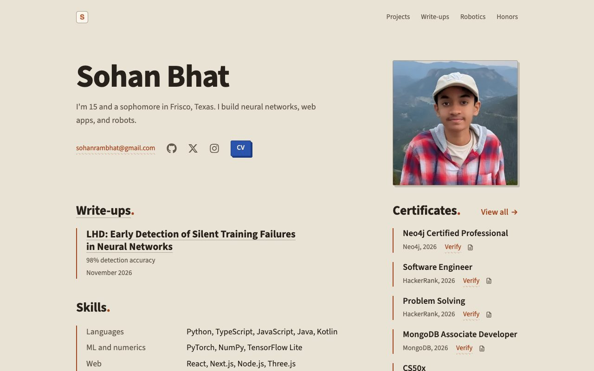

# My Portfolio

[sohanbhat.me](https://sohanbhat.me/)

This repository contains the source code for my personal portfolio website showcasing my skills, projects, and professional experience.

Overview
This portfolio highlights my work as a student developr and showcases my background, technical expertise, and the projects I've created.
